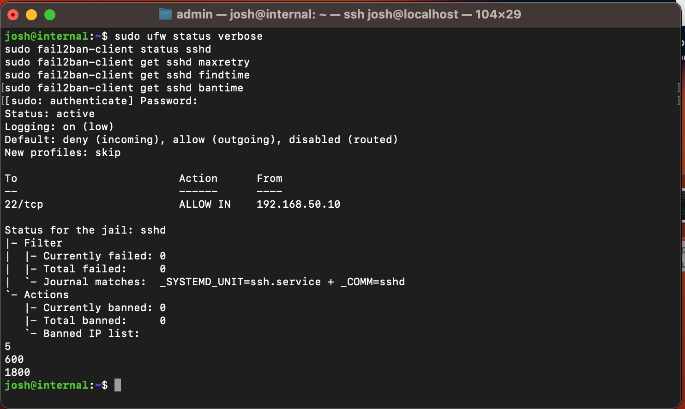

# Linux Secure Jump Server & Network Security Lab

## Project Overview

This project demonstrates the deployment and security hardening of two Ubuntu Server virtual machines using VirtualBox.

The goal is to build a secure administrative environment where a Jump Server acts as the gateway to a protected Internal Server.

## Lab Architecture

- **Admin Workstation:** macOS
- **Jump Server:** Ubuntu Server
- **Internal Server:** Ubuntu Server
- **Virtualization:** Oracle VirtualBox

## Security Implementations

### SSH Authentication
- Configured SSH key-based authentication.
- Established secure SSH access from the Mac to the Jump Server.
- Configured secure SSH access from the Jump Server to the Internal Server.

### Firewall Protection
- Configured UFW on both Ubuntu servers.
- Set incoming traffic to deny by default.
- Allowed SSH traffic on TCP port 22.
- Enabled firewall logging.

### Intrusion Prevention
- Installed and configured Fail2ban on both servers.
- Enabled SSH monitoring.
- Maximum failed attempts: 5.
- Detection window: 10 minutes.
- Ban duration: 30 minutes.

## Skills Demonstrated

- Linux system administration
- SSH configuration and authentication
- Firewall configuration
- Intrusion prevention
- Network security fundamentals
- Virtual machine administration
- Cybersecurity lab documentation

## Project Status

Core server deployment, SSH configuration, firewall verification, and Fail2ban configuration completed.

Additional documentation, network diagrams, and security testing evidence will be added as the project develops.

---

**Disclaimer:** This project is an educational cybersecurity home lab. No production systems were used.

## Screenshots

### Network Topology

### Jump Server Security

### Internal Server Security

