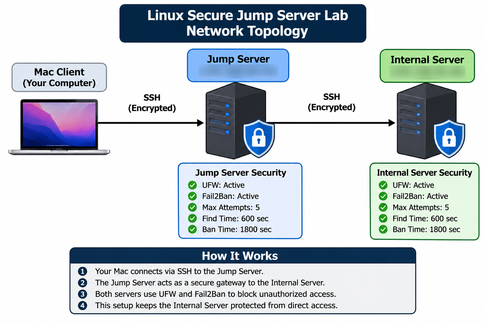
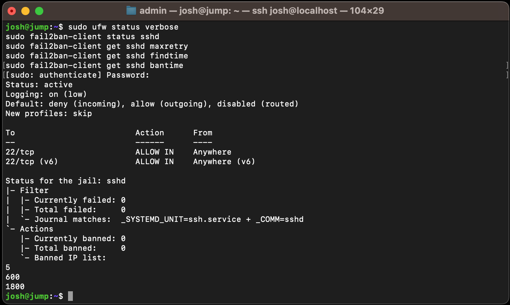

# Linux Secure Jump Server & Network Security Lab

## Project Overview

This project demonstrates the deployment and security hardening of two Ubuntu Server virtual machines using VirtualBox.

The goal is to build a secure administrative environment where a Jump Server acts as the gateway to a protected Internal Server.

## Lab Architecture

- **Admin Workstation:** macOS
- **Jump Server:** Ubuntu Server
- **Internal Server:** Ubuntu Server
- **Virtualization:** Oracle VirtualBox

## Security Implementations

### SSH Authentication
- Configured SSH key-based authentication.
- Established secure SSH access from the Mac to the Jump Server.
- Configured secure SSH access from the Jump Server to the Internal Server.

### Firewall Protection
- Configured UFW on both Ubuntu servers.
- Set incoming traffic to deny by default.
- Allowed SSH traffic on TCP port 22.
- Enabled firewall logging.

### Intrusion Prevention
- Installed and configured Fail2ban on both servers.
- Enabled SSH monitoring.
- Maximum failed attempts: 5.
- Detection window: 10 minutes.
- Ban duration: 30 minutes.

## Skills Demonstrated

- Linux system administration
- SSH configuration and authentication
- Firewall configuration
- Intrusion prevention
- Network security fundamentals
- Virtual machine administration
- Cybersecurity lab documentation

## Project Status

Core server deployment, SSH configuration, firewall verification, and Fail2ban configuration completed.

Additional documentation, network diagrams, and security testing evidence will be added as the project develops.

---

**Disclaimer:** This project is an educational cybersecurity home lab. No production systems were used.

## Screenshots

### Network Topology

### Jump Server Security

### Internal Server Security

## Technical Skills Demonstrated

- **Linux Administration:** Ubuntu Server installation, configuration, and management.
- **SSH Security:** SSH key generation, public-key authentication, and secure remote access.
- **Firewall Management:** UFW configuration and firewall rule verification.
- **Intrusion Prevention:** Fail2ban installation, configuration, and SSH brute-force protection.
- **Network Security:** Jump server architecture and controlled access to an internal server.
- **Security Verification:** Reviewing firewall status, SSH authentication, and Fail2ban settings.
- **Documentation:** Technical documentation, network topology diagrams, and security configuration records.

## Technologies Used

- Ubuntu Server
- Linux
- OpenSSH
- UFW
- Fail2ban
- VirtualBox
- macOS
- GitHub

- ## Network Architecture

This lab uses a two-server architecture to demonstrate controlled remote administration and internal network protection.

### Administrator Workstation
The MacBook Air serves as the administrator workstation and connects to the Jump Server through SSH.

### Jump Server
The Ubuntu Jump Server acts as a secure gateway between the administrator workstation and the internal server.

Security controls:
- SSH remote administration
- UFW firewall
- Fail2ban SSH protection
- Public-key authentication

### Internal Server
The Ubuntu Internal Server hosts protected resources and is accessed through the Jump Server.

Security controls:
- SSH remote administration
- UFW firewall
- Fail2ban SSH protection
- Public-key authentication

### Access Flow

MacBook Pro → Jump Server → Internal Server

The architecture demonstrates the principle of using a controlled gateway to access an internal system rather than connecting directly from the administrator workstation.
